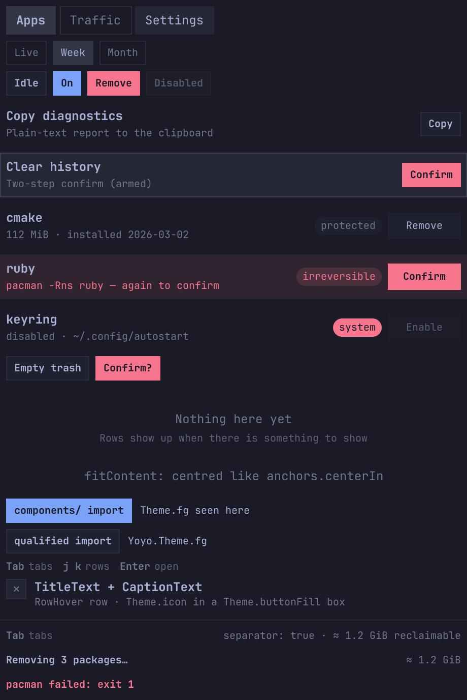

# omarchy-yoyo-ui

Shared QML components for my [Omarchy](https://omarchy.org) shell plugins
(Throttle, System Tidy, Notification Center), so the panels look and behave the
same and the code lives in one place.

Plugins **vendor** a pinned copy into `vendor/yoyo-ui/` (no submodules:
`omarchy plugin add` does a plain clone, and the plugin has to work straight
from that). Every colour, size and font comes from `qs.Commons`
(`Color` + `Style`): the library has no colours of its own.



## Components

| Type | What it is |
| --- | --- |
| `Theme` (singleton) | Colour roles (`fg`, `dim`, `faint`, `accent`, `urgent`, `background`, `line` (0.12), `separator` (0.08, the rule above a footer), `buttonFill` (0.06, idle small buttons), `hoverFill`, `normalFill`, `selectedFill`, `tint(c, a)`), metrics (`edge`, `gap`, `hairline` (divider / border thickness), `rowHeight`, `dataRowHeight`, `smallRowHeight`, panel widths `panelNarrow` 480 / `panelWidth` 520 / `panelWide` 560 for `fittedContentWidth`), type sizes (`caption`, `body`, `title`, `heading`) and icon glyph sizes (`icon`, `iconSmall`). All typed, so qmllint checks `Theme.x` (unlike `Style.spacing.*` / `Style.font.*`, which it sees as plain `QtObject`s). Writable: `foreground`, `fontFamily`. |
| `ChipRow` | Tab / filter chips. `chips: [{ key, label }]`, `selectedKey`, `compact`, `cursorIndex` + `cursorActive` (keyboard cursor), optional `foreground` / `fontFamily`. Signals `selected(key)`, `chipHovered(index)`. |
| `HeaderChip` | Small action chip. `text`, `tooltipText`, `on`, `danger` (urgent fill when lit), optional `foreground` / `fontFamily`; `hovered`. Disable it with the ordinary `Item.enabled` (opacity 0.4, no hover/tooltip). Signals `clicked()` (every click) and `triggered()` (the action: every click, or the confirming one in confirm mode). **Confirm mode** (`confirm: true`): first `activate()` / click arms it (label `confirmText`, default `"Confirm?"`, urgent fill, tooltip `confirmTooltip` if set), the second fires `triggered()`; `armMs` (4000) or `disarm()` cancel; disabling the chip disarms. Pass `controller` + `confirmKey` to share a `ConfirmController`. Read-only `armed`. |
| `ConfirmController` | `QtObject` for two-step actions: `armedKey`, `armed`, `timeout` (4000 ms), `isArmed(key)`, `arm(key)`, `disarm()`, `confirm(key)` (returns `true` if `key` was already armed, and disarms; otherwise arms it and returns `false`). Keys are your own stable strings (e.g. `"packages:" + name`), so the armed row survives ListView reloads. One per panel; call `disarm()` on Esc and cursor moves. |
| `ActionRow` | `CursorSurface` row: `title`, `subtitle`, optional `badge` and one action (`actionLabel`). `actionStyle`: `"chip"` (default, a `HeaderChip` lit while the row has the cursor) or `"button"` (fixed `actionWidth`, default `Style.space(72)`; urgent hover when `danger`; row tinted urgent while armed). `actionVisible`, `actionEnabled` (button: opacity 0.45). `badge` + `badgeVariant` `"normal"` / `"warn"` / `"danger"`. `confirm: true` makes it two-step through a `ConfirmController` (own one with `armMs` 3000, or a shared `controller` + `confirmKey`); while armed the action shows `confirmText` ("Confirm") and the subtitle `armedText` in urgent. `armed` is writable if you run the confirm yourself. `doneText` / `doneMs` (1500) after triggering. `disarmOnLeave` (true): losing the cursor disarms. `activateOnClick` (true): set false to only emit `actionClicked()` and route the click yourself. Signals `rowHovered()`, `actionClicked()`, `triggered()`; method `activate()` (call it on Enter). |
| `EmptyState` | Centred "nothing here yet": `title` (dim, body) + optional `subtitle` (faint, caption). Padding: `topPadding` / `bottomPadding` (`Style.space(24)`) and `spacing` (`Style.space(4)`) are plain `Column` properties, set them to 0 for a tight block. `fitContent: true` sizes each line to its text and centres it with anchors, so it lands on the same whole pixel as `Text { anchors.centerIn: parent }` (the default full-width `AlignHCenter` text can sit half a pixel off). |
| `KeyHints` | Footer hints, `hints: [["Tab", "tabs"], ["j k", "rows"]]`. |
| `RowHover` | `MouseArea` to drop into a row: fills the parent, hovering emits `hovered(rowIndex)` so the panel moves its keyboard cursor there. `clickable` (left clicks, `onClicked`) shows a pointing hand unless `pointer: false`. `rowIndex` (default -1) is passed along. |
| `TitleText` / `CaptionText` | `Text` presets matching `ActionRow`'s title (fg, body, bold) and subtitle (dim, caption); plain text, elide right. Override anything. |
| `StatusFooter` | Footer bar (height `Style.space(18)`): `hints`, replaced by `statusText` while set (`statusKind`: `""`, `"progress"`, `"done"` = accent, `"error"` = urgent), optional `rightText`. `flash(text, kind)` sets a status that clears itself (errors after `errorMs` 6000, others after `doneMs` 2500, `"progress"` stays); `clear()`. `separator: true` draws a `Theme.hairline` rule (`separatorStrength` 0.08) `separatorGap` (`Theme.edge`) above the footer, outside its box, so nothing anchored to the footer moves. |

All of them read `Theme` from their own copy, so they follow whatever the
plugin's `Panel.qml` binds into it.

## Using it in a plugin

### 1. Vendor it

Copy [`tools/sync-ui.sh`](tools/sync-ui.sh) into the plugin as
`tools/sync-ui.sh` (it works on its parent directory, the plugin root), then:

```sh
tools/sync-ui.sh v0.3.0      # or any tag / commit
git add tools/sync-ui.sh vendor/yoyo-ui
```

That clones this repo, checks the ref out and replaces `vendor/yoyo-ui/` with
the contents of `ui/`, plus:

- `vendor/yoyo-ui/VERSION`: `ref`, the full `commit` hash, `repo`;
- `vendor/yoyo-ui/MANIFEST`: sha256 of every vendored file.

`YOYO_UI_REPO=/path/or/url tools/sync-ui.sh <ref>` uses another source (a local
checkout while developing the library). Update = run it again with the new tag
and commit the result.

### 2. Keep it untouched

```sh
tools/sync-ui.sh --check            # fails if any vendored file was edited, added or removed
tools/sync-ui.sh --check-upstream   # also re-fetches the pinned commit and compares (network)
```

Add `tools/sync-ui.sh --check` to your plugin's test script (whatever it
runs in CI or before a release, e.g. `tests/unit.sh` or `tests/run.sh`).
Fixes go here first, get a tag, then get synced; never edit `vendor/yoyo-ui/`.

### 3. Import it

It is a plain **directory import** with a `qmldir` (no `module` line):

```qml
// Panel.qml, BarWidget.qml … (plugin root)
import qs.Commons
import "vendor/yoyo-ui"

// components/*.qml (one level down)
import "../vendor/yoyo-ui"

// or qualified, if a name would clash
import "../vendor/yoyo-ui" as Yoyo   // Yoyo.Theme.fg, Yoyo.ChipRow { … }
```

Then bind the theme to the bar once, in `Panel.qml` (`contentForeground` /
`contentFontFamily` are the Panel's own properties; the library side is
`Theme.foreground` / `Theme.fontFamily`):

```qml
Binding { target: Theme; property: "foreground"; value: root.contentForeground }
Binding { target: Theme; property: "fontFamily"; value: root.contentFontFamily }
```

### Two-step confirm

One controller per panel, keyed by something stable, so Enter and clicks share
it and the armed row survives a model reload:

```qml
ConfirmController { id: confirmCtl; timeout: 4000 }
property alias armedKey: confirmCtl.armedKey        // e.g. for key hints

// Enter on the cursor row:
function request(item) { if (confirmCtl.confirm("pkg:" + item.name)) remove(item) }
// Esc / cursor moves / tab change: confirmCtl.disarm()

delegate: ActionRow {
  actionStyle: "button"
  controller: confirmCtl
  confirmKey: "pkg:" + modelData.name
  activateOnClick: false               // clicks go through request() too
  onActionClicked: root.request(modelData)
  actionLabel: "Remove"; danger: true
  armedText: "pacman -Rns " + modelData.name + " — again to confirm"
}

// or a self-contained chip:
HeaderChip {
  text: "Empty trash"; danger: true; confirm: true
  enabled: trash.length > 0
  onTriggered: store.emptyTrash()
}
```

### Multiple monitors

`Theme` is one singleton per vendored copy, i.e. per plugin, not per panel
instance. If the same plugin shows a panel on two monitors whose bars use
different colours, the last `Binding` to run wins for both. The library does not have
per-instance theming (it would mean passing a theme object to every
component). If you need it, make the binding follow the open panel:

```qml
Binding { target: Theme; property: "foreground"; value: root.contentForeground; when: root.visible }
```

When the panel closes, the Binding restores the previous value. With two
panels open at once, the one opened last wins.

### Import gotchas (verified with quickshell, offscreen, see `tests/run.sh`)

- **Use the relative path import.** `import Yoyo.Ui` does **not** resolve:
  quickshell reports `module "Yoyo.Ui" is not installed`, and a plugin cannot
  add import paths. Only `qs.*` (the shell's own dirs) and relative paths work.
- **One `Theme` per vendored copy.** The singleton is keyed by the directory, so
  `Panel.qml` (`"vendor/yoyo-ui"`), `components/` (`"../vendor/yoyo-ui"`) and
  qualified imports all get the *same* instance: the test retargets
  `Theme.foreground` from `Panel.qml` and checks all three see it. Two plugins
  each have their own copy, so their themes never interfere and they can pin
  different versions.
- **Delete the plugin's old `theme/`** (and stop importing `"theme"`). With both
  imported, `Theme` means two different singletons and the bar bindings only
  reach one of them.
- **Unqualified import beats same-folder files.** If `components/HeaderChip.qml`
  still exists and `components/X.qml` imports `"../vendor/yoyo-ui"`
  unqualified, `HeaderChip` in `X.qml` is the *library* one, silently. Delete
  the local duplicate, or rename it, or import the library qualified.
- **No `module` line in `qmldir`**: keep it a directory qmldir, otherwise every
  plugin's copy would claim the same module URI.
- Needs Omarchy's shell: `qs.Commons` (`Color`, `Style`) and `qs.Ui`
  (`CursorSurface`, `PanelToolTip`).
- qmllint: `qs.Commons` / `qs.Ui` only resolve from a directory that holds
  `qs/Commons` and `qs/Ui`, so link them into a temp dir
  (`mkdir -p $tmp/qs; ln -s /usr/share/omarchy/shell/{Commons,Ui} $tmp/qs/`)
  and run `qmllint -I $tmp -I /usr/lib/qt6/qml <files>`; the vendored dir
  needs no extra `-I`. `ui/` is clean that way (see `tests/run.sh`). Use
  `Theme.hairline` / `Theme.icon` / `Theme.caption` … instead of
  `Style.spacing.hairline` / `Style.font.icon`, which qmllint reports as
  `missing-property`.

## Versioning

Semver tags (`v0.1.0`, …). Patch: fixes with no visual or API change. Minor:
new components / properties, defaults unchanged. Major (or minor while 0.x):
anything that changes how an existing plugin looks or what it must pass.
Plugins pin a tag through `vendor/yoyo-ui/VERSION` and update deliberately.
See [CHANGELOG.md](CHANGELOG.md).

## Tests

```sh
tests/run.sh [OUT_DIR]   # default tests/out
```

Runs qmllint on `ui/` (any warning fails) and ShellCheck on the scripts
(skipped if not installed; `SHELLCHECK=…`), round-trips `tools/sync-ui.sh` against a throwaway repo
(clean `--check`, edited / added / removed file and forged `MANIFEST` all
caught, bad ref fails), then renders `tests/fixture/` (a fake plugin with the
library vendored by the script) offscreen with quickshell, twice (normal and
with `Theme.foreground` retargeted), checking for QML warnings and that every
import site shares one `Theme`, and runs `tests/fixture/logic.qml`: behaviour
checks for `ConfirmController` (arm / confirm / disarm / timeout), `ActionRow`
(own and shared controller, button style, disabled action), `HeaderChip`
confirm mode, `EmptyState { fitContent }` pixel position, the `Theme` tokens,
`StatusFooter { separator }`, `RowHover` and the text styles.
`tests/run.sh docs` re-renders `docs/preview.png`. Needs `qs` and `/usr/share/omarchy/shell`.

## License

MIT
